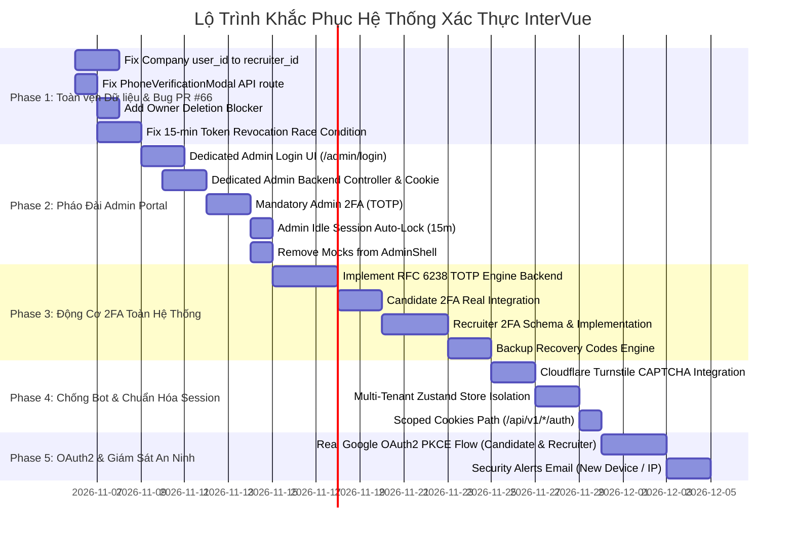

# Báo cáo Thẩm định Bảo mật & Lỗ hổng Kiến trúc Hệ thống Xác thực (Authentication System Security Audit & Roadmap)

> **Tài liệu thẩm định độc lập từ Chuyên gia Kiến trúc Bảo mật & IAM (Identity and Access Management)**  
> **Dự án:** InterVue Platform (AI-Assisted IT Recruitment)  
> **Phạm vi thẩm định:** Backend (Spring Boot 4.1, Java 25, MySQL, Redis, JWT) & Frontend (Next.js 16, React 19, Zustand)  
> **Thời điểm thẩm định:** Sau khi hoàn tất tích hợp PR #66 (`feat/auth-separate-portals`) vào nhánh `dev`  
> **Trạng thái:** Yêu cầu khắc phục khẩn cấp trước khi bàn giao Production

---

## Tóm tắt Đánh giá từ Chuyên gia (Executive Summary)

Sau khi kiểm toán toàn diện mã nguồn backend, frontend và kiểm tra thực nghiệm việc phân tách 2 realm Candidate và Recruiter trong PR #66, **kết luận thẩm định chuyên môn như sau:**

1. **Ghi nhận tích cực:** Hệ thống đã bắt đầu hình thành ranh giới phân tách dữ liệu rõ ràng giữa Candidate (`users`) và Recruiter (`recruiters`). Bộ lọc `JwtAuthFilter` cùng các cấu hình tại `SecurityConfig.java` đã chặn được token chéo (Recruiter token không gọi được `/users/me/*` và ngược lại).
2. **Cảnh báo mức độ Nghiêm trọng (Critical / High):** Hệ thống xác thực hiện tại **chưa đạt tiêu chuẩn an toàn cho môi trường Enterprise Production**. Hệ thống đang tồn tại **4 lỗ hổng nghiêm trọng (P0)**, **6 bất cập kiến trúc mức độ cao (P1)**, và một "vùng mù" kiến trúc hoàn toàn đối với vai trò **ADMIN**.
3. **Các tính năng đang ở dạng "Mặt nạ" (Security Facade):** Rất nhiều cơ chế bảo vệ thực chất chỉ là giao diện giả lập (Mock UI) hoặc cờ tín hiệu chưa có logic thực thi phía backend:
   - Tính năng 2FA (Two-Factor Authentication) trên frontend là mock UI 100% với secret key tĩnh. Backend chưa có bất kỳ service nào để tạo/kiểm tra mã TOTP trong luồng đăng nhập.
   - Cơ chế CAPTCHA chống brute-force chỉ trả về cờ `captchaRequired = true`, hoàn toàn không có bước tiếp nhận hay xác thực captcha token từ Cloudflare hay Google.
   - Đăng nhập mạng xã hội (Google, Facebook, LinkedIn) chỉ hiển thị popup `alert()`.
   - Giao diện Admin Shell đang hardcode import từ file mock dữ liệu.

---

## Bảng tổng hợp Lỗ hổng & Phân cấp Ưu tiên (Audit Scorecard)

| Mã ID | Phân loại | Cấp độ | Vấn đề cốt lõi | Rủi ro thực tế |
|---|---|---|---|---|
| **SEC-01** | Architecture / Session | **P0 (Critical)** | Cửa sổ thu hồi Token 15 phút & Lỗi Race Condition trong `UserSessionCache` | Thiết bị bị thu hồi hoặc tài khoản bị ban vẫn có thể gọi API hợp lệ tối đa 15 phút. |
| **SEC-02** | Data Integrity | **P0 (Critical)** | Bảng `company_members` và `company_agreements` vẫn trỏ khóa ngoại `user_id` vào `users.id` thay vì `recruiters.id` | Trùng ID giữa Candidate và Recruiter, sai lệch quyền sở hữu công ty, nguy cơ vi phạm ràng buộc dữ liệu. |
| **SEC-03** | Authorization / Business | **P0 (Critical)** | Xóa tài khoản Recruiter không có chốt chặn kiểm tra Doanh nghiệp (`LAST_COMPANY_OWNER`) | Chủ sở hữu duy nhất xóa tài khoản khiến Công ty bị mồ côi (orphaned), tê liệt vận hành. |
| **SEC-04** | Admin IAM | **P0 (Critical)** | Hoàn toàn KHÔNG CÓ cổng đăng nhập, UX/UI xác thực và chính sách bảo vệ riêng cho ADMIN | Admin đăng nhập chung với Candidate, dùng chung cookie, không bắt buộc 2FA, không có IP whitelist. |
| **SEC-05** | MFA / 2FA Engine | **P1 (High)** | Hệ thống 2FA (TOTP) là "giao diện giả lập" (Mock UI) và thiếu hoàn toàn ở Backend | Mật khẩu lộ là tài khoản bị chiếm đoạt 100%, không có lớp phòng thủ số 2. |
| **SEC-06** | Frontend Multi-Tenant | **P1 (High)** | Zustand Store chỉ lưu 1 session duy nhất (`accessToken`, `user`) cho toàn bộ trình duyệt | Mở 2 tab Recruiter và Candidate gây đè token, gọi nhầm endpoint dẫn tới lỗi 403 Forbidden liên tục. |
| **SEC-07** | Anti-Bot / CAPTCHA | **P1 (High)** | Cờ `captchaRequired` trả về nhưng không có bộ xác thực CAPTCHA | Hacker dùng script brute-force bỏ qua cờ này và tiếp tục tấn công từ điển không giới hạn. |
| **SEC-08** | API Integration | **P1 (High)** | Frontend Modal xác minh SĐT Recruiter trỏ nhầm vào API Candidate (`/users/me/phone/*`) | Recruiter bấm xác minh SĐT doanh nghiệp bị lỗi 403 hoặc lệch dữ liệu. |
| **SEC-09** | Session Scope | **P2 (Medium)** | Cookie `refresh_token` và `recruiter_refresh_token` đều đặt `Path=/` | Trình duyệt gửi cả 2 cookie trong mọi request, vi phạm nguyên tắc tối thiểu hóa phạm vi dữ liệu. |
| **SEC-10** | Observability | **P2 (Medium)** | Thiếu cơ chế phát hiện & gửi email cảnh báo đăng nhập bất thường (New Device / IP) | Người dùng không hề biết khi tài khoản bị đăng nhập từ thiết bị hoặc quốc gia lạ. |

---

## PHẦN I: Phân tích Chi tiết Nợ Kỹ thuật Từ PR #66 (Forensic Post-Merge Debt)

Mặc dù PR #66 đã hợp nhất vào `dev`, các khoản nợ kỹ thuật sau đây cần phải được khắc phục ngay lập tức:

### 1. Cửa sổ Thu hồi Token 15 phút (The 15-Minute Zombie Token & Cache Race Condition)

- **Vị trí code:** 
  - [`AccountSecurityService.java`](file:///Users/maaitlunghau/Documents/Projects/intervue/backend/src/main/java/com/techx/intervue/modules/user/services/impl/AccountSecurityService.java#L95-L118)
  - [`RecruiterAccountSecurityService.java`](file:///Users/maaitlunghau/Documents/Projects/intervue/backend/src/main/java/com/techx/intervue/modules/recruiter/services/impl/RecruiterAccountSecurityService.java#L85-L105)
  - [`JwtAuthFilter.java`](file:///Users/maaitlunghau/Documents/Projects/intervue/backend/src/main/java/com/techx/intervue/filters/JwtAuthFilter.java#L73-L97)
  - [`UserSessionCache.java`](file:///Users/maaitlunghau/Documents/Projects/intervue/backend/src/main/java/com/techx/intervue/modules/user/services/impl/UserSessionCache.java#L22-L48)
- **Cơ chế hiện tại:**
  Khi một người dùng đăng xuất từ xa một thiết bị khác (Remote Revoke Session) hoặc Đổi mật khẩu:
  1. Backend đánh dấu `is_revoked = true` trong bảng `refresh_tokens`.
  2. Backend gọi `userSessionCache.evict(userId)`.
  3. **VẤN ĐỀ:** Hệ thống KHÔNG HỀ đưa `jti` của Access Token đang hoạt động của thiết bị đó vào Redis Blacklist (`blacklistService.revoke(jti, exp)`).
- **Lỗ hổng Race Condition chết người:**
  - `UserSessionCache` lưu trữ session với key là `user:session:{userId}` (theo `userId`, **chứ không theo từng phiên/thiết bị**).
  - Khi thiết bị A bấm "Đăng xuất thiết bị B", `userSessionCache.evict(userId)` xóa key `user:session:{userId}`.
  - Tuy nhiên, chỉ cần thiết bị A thực hiện request tiếp theo hoặc thực hiện refresh token, hệ thống lại gọi `userSessionCache.set(userId, ...)` và nạp lại key này vào Redis với TTL 7 ngày!
  - Lúc này, thiết bị B (kẻ trộm / máy bị mất) vẫn đang giữ Access Token có thời hạn 15 phút. Khi thiết bị B gửi request:
    - JWT signature: Hợp lệ.
    - Expiration: Còn hạn.
    - `blacklistService.isRevoked(jti)`: Trả về `FALSE` (vì `jti` chưa từng bị blacklist).
    - `userSessionCache.get(userId)`: Trả về **HỢP LỆ** (do thiết bị A vừa nạp lại vào Redis).
  - **Hệ quả:** Thiết bị B tiếp tục truy cập dữ liệu và thực hiện hành động mạo danh trong tối đa 15 phút mà không gặp bất kỳ trở ngại nào.

### 2. Sự Lệch pha Giữa Mô hình Recruiter và Module Company (Data Boundary Hazard)

- **Vị trí code:** 
  - [`CompanyMember.java`](file:///Users/maaitlunghau/Documents/Projects/intervue/backend/src/main/java/com/techx/intervue/modules/company/entities/CompanyMember.java#L41-L42)
  - [`CompanyAgreement.java`](file:///Users/maaitlunghau/Documents/Projects/intervue/backend/src/main/java/com/techx/intervue/modules/company/entities/CompanyAgreement.java)
- **Vấn đề:**
  - Bảng `company_members` và `company_agreements` được thiết kế từ trước khi tách bảng `recruiters`. Cột định danh thành viên đang là `user_id` và có ràng buộc khóa ngoại tới bảng `users(id)`.
  - Trong khi đó, người dùng đăng nhập vào cổng nhà tuyển dụng sẽ mang `CustomUserDetails.id` lấy từ bảng `recruiters.id`.
  - Giả sử Recruiter có `recruiters.id = 1` và Candidate có `users.id = 1`: Khi Recruiter thực hiện thao tác trong Công ty, nếu hệ thống truy vấn theo `user_id = 1`, nó có thể vô tình liên kết nhầm với dữ liệu của Candidate có ID = 1, hoặc nếu `recruiters.id = 99` chưa hề tồn tại trong `users`, lệnh INSERT sẽ phát sinh lỗi vi phạm toàn vẹn khóa ngoại (Foreign Key Violation).

### 3. Thiếu Chốt chặn Xóa Tài khoản Recruiter là Chủ Sở hữu Doanh nghiệp

- **Vị trí code:**
  - [`RecruiterService.java`](file:///Users/maaitlunghau/Documents/Projects/intervue/backend/src/main/java/com/techx/intervue/modules/recruiter/services/impl/RecruiterService.java#L70-L85)
- **Vấn đề:**
  - API `POST /api/v1/recruiter/me/delete-request` cho phép Recruiter yêu cầu xóa tài khoản (7 ngày ân hạn).
  - Hệ thống hiện tại chỉ kiểm tra `recruiter.getStatus() != RecruiterStatus.SUSPENDED`.
  - **Thiếu sót:** Không hề kiểm tra xem Recruiter này có đang là `OWNER` duy nhất của một Công ty đang hoạt động hay không (`CompanyMemberRole.OWNER`).
  - Nếu cho phép chủ doanh nghiệp yêu cầu xóa tài khoản, doanh nghiệp đó sẽ bị mất người đại diện pháp lý trên hệ thống, không ai có quyền duyệt hồ sơ, ký thỏa thuận điện tử (`CompanyAgreement`) hay quản trị thành viên khác.

### 4. Lỗi Tích hợp Frontend: Modal Xác minh SĐT Recruiter Gọi Nhầm API Candidate

- **Vị trí code:**
  - [`frontend/components/recruiter/company/verification/PhoneVerificationModal.tsx`](file:///Users/maaitlunghau/Documents/Projects/intervue/frontend/components/recruiter/company/verification/PhoneVerificationModal.tsx#L4)
  - [`frontend/hooks/useCompanyVerification.ts`](file:///Users/maaitlunghau/Documents/Projects/intervue/frontend/hooks/useCompanyVerification.ts#L3)
  - [`frontend/apiRequest/phone-verification.ts`](file:///Users/maaitlunghau/Documents/Projects/intervue/frontend/apiRequest/phone-verification.ts#L4-L16)
- **Vấn đề:**
  - Trong PR #66, helper chuẩn hóa `accountSecurityApiFor('recruiter')` đã được tạo ra trong `frontend/apiRequest/account-security.ts` để gọi đúng `/recruiter/me/phone/*` với body `{ code }`.
  - Tuy nhiên, component `PhoneVerificationModal.tsx` và hook `useCompanyVerification.ts` (thuộc luồng doanh nghiệp) vẫn đang import file cũ `phoneVerificationApi`.
  - File cũ này gửi POST đến `/users/me/phone/send-otp` và `/users/me/phone/verify` với body `{ otp }`.
  - Kết quả: Khi Recruiter nhấn gửi/xác minh OTP trong quy trình xác minh công ty, Spring Security lập tức chặn lại và trả về **403 Forbidden** (do Recruiter token không được phép gọi endpoint `/users/me/*`).

### 5. Thiếu Modal Xác nhận Mật khẩu Trước khi Gửi OTP SMS

- **Vấn đề thực tế:**
  - Trước đây trong luồng xác thực số điện thoại đã thống nhất yêu cầu: Người dùng phải xác nhận lại mật khẩu tài khoản (Confirm Password Modal) trước khi hệ thống kích hoạt gửi OTP qua SMS.
  - Mục đích bảo mật: Ngăn chặn kẻ xấu mượn máy hoặc chiếm quyền tạm thời bấm gửi OTP liên tục, bảo vệ số dư tài khoản SMS Gateway của hệ thống và chống tấn công từ chối dịch vụ (SMS Bombing).
  - Trong bản giao diện hiện tại, bước này đã bị lược bỏ, cho phép bấm thẳng gửi OTP.

---

## PHẦN II: Đánh giá Chuyên sâu theo 3 Role (Deep IAM Role-by-Role Audit)

---

### ROLE 1: ADMIN (Quản trị viên Hệ thống) — "Lãnh thổ Vô hình & Nguy cơ Tối thượng"

> **Mức độ nghiêm trọng: CRITICAL (P0)**  
> **Nhận định chuyên gia:** Phân hệ Admin hiện tại đang hoàn toàn bị bỏ quên về mặt kiến trúc xác thực (IAM Architecture Blind Spot). Việc một tài khoản nắm giữ quyền kiểm soát tối cao toàn bộ nền tảng nhưng lại sử dụng cơ chế bảo mật nghèo nàn hơn cả người dùng thông thường là một lỗ hổng không thể chấp nhận được.

```mermaid
flowchart TD
    subgraph Current_Flawed_Flow["Luồng Hiện Tại (Nhiều Rủi Ro)"]
        AdminUser["Admin"] -->|Truy cập /admin/*| LayoutCheck{"RequireAuth"}
        LayoutCheck -->|Chưa đăng nhập| RedirectCandidate["Chuyển hướng đến /login (Cổng Candidate)"]
        RedirectCandidate -->|Nhập email + pass| SharedAuthEndpoint["/api/v1/auth/login"]
        SharedAuthEndpoint -->|Cấp cookie dùng chung| SharedCookie["refresh_token (Path=/)"]
        SharedCookie -->|Truy cập Admin| AdminShellMock["Admin Shell (Dữ liệu Mock 100%)"]
    end

    subgraph Standard_Enterprise_Flow["Kiến Trúc Chuẩn Enterprise Cần Đạt"]
        AdminSafe["Admin"] -->|Truy cập /admin/*| DedicatedAdminLogin["Cổng riêng: /admin/login"]
        DedicatedAdminLogin -->|IP/CIDR Whitelist check| FirewallGate{"Firewall / WAF"}
        FirewallGate -->|Hợp lệ| AdminAuthEndpoint["/api/v1/admin/auth/login"]
        AdminAuthEndpoint -->|Mật khẩu đúng| Mandatory2FA{"Bắt buộc TOTP 2FA"}
        Mandatory2FA -->|Xác nhận OTP| DedicatedCookie["Cookie: admin_refresh_token (Path=/api/v1/admin)"]
        DedicatedCookie -->|Idle 15m timeout| AutoLock["Tự động khóa màn hình (Session Lock)"]
    end
```



#### 1. Không có Cổng Đăng nhập và UI/UX Xác thực Riêng cho Admin
- **Hiện trạng:** 
  - Không hề tồn tại route `/admin/login` hay bất kỳ form đăng nhập nào được thiết kế dành riêng cho Quản trị viên.
  - Khi một người dùng chưa đăng nhập truy cập vào `/admin/dashboard`, component [`RequireAuth.tsx`](file:///Users/maaitlunghau/Documents/Projects/intervue/frontend/components/auth/RequireAuth.tsx#L25) kiểm tra:
    ```typescript
    const loginRoute = isRecruiterPortal() ? ROUTES.RECRUITER_LOGIN : ROUTES.LOGIN;
    router.replace(`${loginRoute}?${REDIRECT_PARAM}=${encodeURIComponent(current)}`);
    ```
    Hệ thống đẩy Admin thẳng về trang `/login` thông thường của Candidate!
- **Hệ quả kiến trúc:**
  - Tạo ra sự nhầm lẫn nghiêm trọng về mặt trải nghiệm và nhận diện thương hiệu nội bộ.
  - Không thể áp dụng các chính sách bảo mật riêng cho Admin tại tầng ứng dụng (như ẩn form đăng nhập công khai, giới hạn lượt thử gắt gao hơn, hoặc hiển thị cảnh báo bảo mật nội bộ).

#### 2. Dữ liệu Giao diện Quản trị (`AdminShell`) Đang Bị Hardcode Mock Dữ Liệu
- **Hiện trạng:**
  Tại file [`frontend/app/(admin)/layout.tsx`](file:///Users/maaitlunghau/Documents/Projects/intervue/frontend/app/(admin)/layout.tsx#L5-L16):
  ```typescript
  import { getAdminAccountState } from '@/mocks/admin-account.mock';
  import { getAdminQueueCounts } from '@/mocks/admin-dashboard.mock';
  
  export default function AdminLayout({ children }: { children: ReactNode }) {
    const queueCounts = getAdminQueueCounts();
    const account = getAdminAccountState();
    return (
      <RequireAuth roles={[ROLES.ADMIN]} forbiddenFallback={<NotFoundView />}>
        <AdminShell queueCounts={queueCounts} account={account}>
  ```
  Thông tin tài khoản Admin, trạng thái 2FA của Admin (`twoFactorEnabled: false`), và số lượng hàng đợi duyệt đều lấy từ các hàm mock tĩnh. Giao diện Admin chưa hề kết nối với API thực tế để lấy trạng thái profile của chính Admin đang đăng nhập.

#### 3. Hoàn toàn Không có Cơ chế Bắt buộc Xác thực 2 Yếu tố (MFA/TOTP Enforcement)
- **Hiện trạng:** 
  - Tài khoản Admin có quyền hạn tối cao: Duyệt hồ sơ pháp lý công ty, Banned tài khoản, phân quyền quản trị, xem nhật ký kiểm toán hệ thống.
  - Tuy nhiên, Admin chỉ cần nhập email và mật khẩu là vào thẳng trang quản trị.
  - Không có bất kỳ rào cản xác thực 2 bước nào (Google Authenticator, Microsoft Authenticator, hay Hardware Security Key WebAuthn/FIDO2).
- **Yêu cầu bảo mật tiêu chuẩn:** Mọi tài khoản có quyền `ROLE_ADMIN` **BẮT BUỘC (MANDATORY)** phải kích hoạt TOTP 2FA ngay lần đầu đăng nhập. Không cho phép truy cập bất kỳ tính năng quản trị nào nếu chưa xác thực 2FA.

#### 4. Thiếu Kiểm soát Mạng & Địa chỉ IP (No IP Whitelisting / VPN Restriction)
- Toàn bộ endpoint `/api/v1/admin/**` hiện mở công khai ra Internet. Bất kỳ ai trên thế giới nếu đoán hoặc đánh cắp được mật khẩu Admin đều có thể gửi request trực tiếp vào backend.
- Cần có cấu hình cho phép giới hạn dải IP (CIDR Whitelist) hoặc yêu cầu header xác thực thông qua VPN / Reverse Proxy Gateway đối với các route quản trị.

#### 5. Thiếu Thời Gian Chờ Phiên Làm Việc (Admin Session Idle Timeout)
- Phiên đăng nhập của Admin hiện tại có cùng thời gian sống như Candidate thông thường: Refresh Token kéo dài đến 7 ngày.
- Nếu Quản trị viên rời khỏi bàn làm việc hoặc quên khóa máy tính, phiên làm việc vẫn mở nguyên vẹn trong nhiều ngày.
- **Yêu cầu:** Phiên làm việc của Admin phải có cơ chế **Idle Session Timeout** (Tự động khóa màn hình sau 15–30 phút không có thao tác chuột/bàn phím, yêu cầu nhập lại mật khẩu/mã OTP để mở khóa).

#### 6. Dùng Chung Cookie và Nguy Cơ Ô Nhiễm Phiên Làm Việc (Session Pollution)
- Admin dùng chung cookie `refresh_token` với Candidate trên phạm vi `Path=/`.
- Nếu trên cùng một trình duyệt, người quản trị mở tab khác để kiểm tra tính năng của ứng viên và đăng nhập tài khoản test, cookie `refresh_token` của Admin sẽ bị ghi đè hoàn toàn, làm gián đoạn phiên làm việc quản trị.

#### 7. Thiếu Cơ Chế Xác Thực Lại Khi Thực Hiện Thao Tác Nguy Hiểm (Step-Up Re-Authentication)
- Khi Admin thực hiện các thao tác phá hủy hoặc ảnh hưởng lớn: Ban tài khoản vĩnh viễn, phân quyền `ROLE_ADMIN` cho người khác, xóa dữ liệu nhạy cảm, hoặc tải xuống audit log; hệ thống **không yêu cầu nhập lại mật khẩu hoặc OTP (Sudo Mode / Step-Up Auth)**.
- Nếu phiên làm việc bị Cross-Site Scripting (XSS) hoặc bị clickjacking, kẻ tấn công có thể âm thầm kích hoạt các API phá hoại này.

---

### ROLE 2: RECRUITER (Nhà tuyển dụng) — "Bất cập Phân tách & Trải nghiệm Doanh nghiệp"

> **Mức độ nghiêm trọng: HIGH (P1)**  
> **Nhận định chuyên gia:** PR #66 đã hoàn thành tốt việc tạo bảng riêng và API riêng, nhưng để vận hành doanh nghiệp thực tế, phân hệ này còn thiếu sót nghiêm trọng về bảo mật đa yếu tố và khả năng xử lý đa phiên trên client.

#### 1. Xung đột Trạng thái trên Frontend (Single Global Zustand Auth Store)
- **Hiện trạng:**
  Tại [`frontend/store/auth.store.ts`](file:///Users/maaitlunghau/Documents/Projects/intervue/frontend/store/auth.store.ts):
  ```typescript
  type AuthState = {
    status: AuthStatus;
    accessToken: string | null;
    user: User | null;
    // ...
  };
  ```
  Zustand store được khởi tạo dạng **đơn nhất (Single instance)** cho toàn bộ ứng dụng Next.js.
- **Kịch bản lỗi điển hình:**
  Một người dùng vừa là nhà tuyển dụng vừa là ứng viên:
  1. Người dùng mở Tab 1: Đăng nhập Cổng Recruiter (`/recruiter/dashboard`). Zustand lưu Access Token của Recruiter.
  2. Người dùng mở Tab 2: Truy cập trang Việc làm của Ứng viên (`/account/security` hoặc `/jobs`).
  3. Khi Tab 2 thực hiện request đến backend `/api/v1/users/me`, nó lấy `accessToken` từ Zustand store (vốn là token Recruiter).
  4. Backend `SecurityConfig` phát hiện token Recruiter gửi vào endpoint Candidate -> Trả về ngay lập tức **403 Forbidden**.
  5. Người dùng bị văng ra trang lỗi hoặc bị xóa session bất thường.

#### 2. Hoàn Toàn Chưa Có 2FA Cho Nhà Tuyển Dụng
- Bảng `recruiters` trong database hoàn toàn không có bảng liên kết `recruiter_two_factor` hay `recruiter_two_factor_recovery_codes`.
- Module `recruiter` trên backend không hề có controller/service nào phục vụ 2FA.
- Trên giao diện [`/recruiter/account/security`](file:///Users/maaitlunghau/Documents/Projects/intervue/frontend/app/(recruiter)/recruiter/account/security), mục thiết lập bảo vệ chỉ có đổi mật khẩu, quản lý phiên và xác minh số điện thoại; hoàn toàn không có lựa chọn kích hoạt Google/Microsoft Authenticator.
- Trong kỷ nguyên bảo mật dữ liệu doanh nghiệp (CV ứng viên, mức lương, thông tin nội bộ), việc Recruiter không có 2FA là một rủi ro tuân thủ pháp lý (GDPR / Nghị định 13/2023/NĐ-CP).

#### 3. Tính Năng Đăng Nhập Bằng Google Hoàn Toàn Là Nút Bấm "Rỗng"
- Tại [`frontend/components/auth/SocialAuthButtons.tsx`](file:///Users/maaitlunghau/Documents/Projects/intervue/frontend/components/auth/SocialAuthButtons.tsx#L41-L43):
  ```typescript
  const handleSocialAuth = (provider: string) => {
    alert(`Connecting with ${provider}...`);
  };
  ```
  Nút bấm "Sign in with Google" trên trang đăng nhập Recruiter chỉ bật một hộp thoại JavaScript `alert()`. Backend chưa hề có OAuth2 Client configuration, chưa có endpoint `/api/v1/recruiter/auth/oauth2/google`, và chưa có cơ chế mapping tài khoản Google với bảng `recruiters`.

#### 4. Nguy cơ Bị Tấn công Từ điển & Spam OTP
- Dù backend có rate limiting cơ bản, việc gửi OTP qua số điện thoại `/api/v1/recruiter/me/phone/send-otp` chưa đi kèm bảo vệ CAPTCHA.
- Nếu một tài khoản bị xâm nhập hoặc lộ token, kẻ tấn công có thể viết bot spam gửi OTP liên tục làm tiêu hao hạn mức SMS Gateway của doanh nghiệp.

---

### ROLE 3: CANDIDATE (Ứng viên) — "Hàng Giả" 2FA & Lỗ hổng Token

> **Mức độ nghiêm trọng: MEDIUM-HIGH (P1/P2)**  
> **Nhận định chuyên gia:** Cổng ứng viên có bề ngoài hoàn chỉnh nhất nhưng thực chất nhiều cơ chế bảo mật then chốt đang ở trạng thái "ngụy trang", đánh lừa cảm giác an toàn của người dùng.

#### 1. Tính Năng 2FA Đang Là "Giao diện Giả" (Fake Mock UI 100%)
- **Hiện trạng kiểm tra thực tế:**
  - Tại component [`frontend/components/account/AccountTwoFactorView.tsx`](file:///Users/maaitlunghau/Documents/Projects/intervue/frontend/components/account/AccountTwoFactorView.tsx#L8-L67):
    Mã khóa Secret được hardcode cứng: `const SECRET_KEY = 'IV26-9A8F-4C21-7890';`
    Mã dự phòng Backup Codes được hardcode cứng 8 chuỗi số.
    Khi người dùng nhập 6 số bất kỳ vào ô OTP và nhấn Xác nhận:
    ```typescript
    setTimeout(() => {
      setIsLoading(false);
      setIsEnabled(true);
      setSuccessMsg('Two-factor authentication is now active...');
    }, 800);
    ```
    Hệ thống dùng `setTimeout` 800ms để giả lập kích hoạt thành công trên local state của React! Không hề có một byte dữ liệu nào được gửi lên server!
  - **Phía Backend:**
    Dù có 2 entity `UserTwoFactor` và `UserTwoFactorRecoveryCode`, trong [`AuthService.java`](file:///Users/maaitlunghau/Documents/Projects/intervue/backend/src/main/java/com/techx/intervue/modules/user/services/impl/AuthService.java#L60-L79) ở hàm `login()`, **HOÀN TOÀN KHÔNG CÓ BƯỚC KIỂM TRA XEM USER CÓ BẬT 2FA HAY KHÔNG**.
    Kể cả nếu trong database user có record 2FA, hệ thống vẫn cấp thẳng Access Token và Refresh Token ngay khi mật khẩu khớp!
- **Hệ quả:** Tính năng 2FA hiện tại hoàn toàn là một "lâu đài cát", tạo cảm giác an tâm giả tạo cho người dùng trong khi thực tế tài khoản hoàn toàn không được bảo vệ.

#### 2. Cơ chế Chống Brute Force Bằng CAPTCHA Là "Bù Nhìn" (Dummy CAPTCHA Gate)
- **Hiện trạng:**
  Trong [`LoginAttemptService.java`](file:///Users/maaitlunghau/Documents/Projects/intervue/backend/src/main/java/com/techx/intervue/modules/user/services/impl/LoginAttemptService.java#L32-L34), sau khi đăng nhập sai quá số lần quy định, hàm `isCaptchaRequired(email, ip)` trả về `true`.
  Backend ném ngoại lệ kèm meta: `throw AppException.invalidCredentials(true);`.
  Tuy nhiên:
  - Class [`LoginRequest.java`](file:///Users/maaitlunghau/Documents/Projects/intervue/backend/src/main/java/com/techx/intervue/modules/user/requests/LoginRequest.java) chỉ có 2 trường `email` và `password`. Không hề có trường `captchaToken`.
  - Backend không tích hợp bất kỳ SDK nào của Cloudflare Turnstile hay Google reCAPTCHA để verify token với server của nhà cung cấp.
  - Hacker dùng script tự động chỉ cần tiếp tục gửi HTTP POST với email và password mà không cần giải bất kỳ captcha nào. Backend chỉ thông báo "phải có captcha" nhưng không hề kiểm tra sự hiện diện hay tính hợp lệ của captcha token!

#### 3. Lỗ hổng Quy trình Đổi Email (Email Change Flow)
- Quy trình đổi email hiện tại: Gửi link xác nhận đến email mới (thời hạn 24h), đồng thời gửi một email thông báo đến email cũ.
- **Thiếu sót:** Email thông báo gửi đến email cũ chỉ mang tính chất thông tin thuần túy. Nếu tài khoản của Candidate bị hacker đột nhập và yêu cầu đổi email vào lúc nửa đêm, người dùng không có nút bấm khẩn cấp **"Đây không phải là tôi - Khóa tài khoản và Hủy yêu cầu ngay lập tức"** (One-click Freeze & Abort Link). Đến khi người dùng thức dậy thì tài khoản đã bị sang tên đổi chủ.

---

## PHẦN III: Lỗ hổng Kiến trúc Cốt lõi Toàn Hệ thống (System-Wide Architectural Flaws)

---

### 1. Kiến Trúc Cookie Không Phân Định Phạm Vi (Cookie Scoping Failure: `Path=/`)
- **Vấn đề:**
  Trong [`CookieHelper.java`](file:///Users/maaitlunghau/Documents/Projects/intervue/backend/src/main/java/com/techx/intervue/modules/helpers/CookieHelper.java#L11-L24):
  Cả hai hàm tạo cookie:
  ```java
  public static ResponseCookie buildRefreshTokenCookie(String token, Duration maxAge) {
      return buildCookie(REFRESH_TOKEN_COOKIE, token, "/", maxAge);
  }
  public static ResponseCookie buildRecruiterRefreshTokenCookie(String token, Duration maxAge) {
      return buildCookie(RECRUITER_REFRESH_TOKEN_COOKIE, token, "/", maxAge);
  }
  ```
  Cả hai cookie đều được gán `Path="/"`.
- **Hậu quả:**
  Trình duyệt web sẽ tự động đính kèm **cả hai cookie** trong bất kỳ HTTP request nào gửi tới bất kỳ endpoint nào của domain.
  Điều này làm tăng kích thước request header, gây rò rỉ cookie qua lại giữa các portal, và khiến việc định tuyến phiên đăng nhập trên frontend dễ bị sai lệch nếu logic đọc cookie không chặt chẽ.
- **Chuẩn hóa kiến trúc:**
  Cookie phải được đóng gói chính xác theo phạm vi đường dẫn API:
  - Candidate Refresh Cookie: `Path="/api/v1/auth"`
  - Recruiter Refresh Cookie: `Path="/api/v1/recruiter/auth"`
  - Admin Refresh Cookie: `Path="/api/v1/admin/auth"`

### 2. Mô hình Thu hồi Token: Stateless JWT Đối đầu Thực tế Bảo mật
- Access Token hiện tại được thiết lập thời hạn 15 phút. Hệ thống sử dụng mô hình Stateless JWT với mong muốn giảm tải truy vấn cơ sở dữ liệu.
- Tuy nhiên, trong các nghiệp vụ nhạy cảm như Đổi mật khẩu, Thu hồi thiết bị từ xa, Ban tài khoản, và Xóa tài khoản; tính chất "Stateless" lại biến thành điểm yếu chí tử: **Server không thể ép buộc client hủy token ngay lập tức nếu không duy trì một danh sách đen (Blacklist) hoặc cơ chế Token Version**.
- Việc dùng `UserSessionCache` theo `userId` để bù đắp đã thất bại vì lỗi Race Condition như đã phân tích tại Phần I.

### 3. Thiếu Toàn Diện Hệ Thống Cảnh Báo An Ninh (Security Notification & SIEM Alerting)
- Hệ thống hiện tại hoàn toàn "im lặng" khi có các biến cố bảo mật quan trọng:
  - Đăng nhập từ một thiết bị / trình duyệt mới hoàn toàn.
  - Đăng nhập từ một địa chỉ IP / vị trí địa lý bất thường (ví dụ: đang ở Hà Nội bỗng đăng nhập từ Nga/Mỹ).
  - Nhập sai mật khẩu liên tiếp 5 lần.
  - Yêu cầu xóa tài khoản được kích hoạt.
- Không có bất kỳ email cảnh báo nào được gửi đến người dùng để họ chủ động phòng vệ.

---

## PHẦN IV: Lộ trình Khắc phục Chi tiết & Tiêu chuẩn Triển khai (Actionable Remediation Roadmap)

Dưới đây là bản kế hoạch hành động từng bước (Step-by-step Execution Plan) được chia theo các giai đoạn ưu tiên, sẵn sàng để đội ngũ phát triển tiến hành code và hoàn thiện triệt để.



---

### GIAI ĐOẠN 1: Khắc phục Ngay Lập tức (P0 - Quick Wins & Integrity - Ước tính: 2–3 ngày)

Mục tiêu: Đóng băng các lỗi dữ liệu nguy hiểm và xử lý triệt để các tồn dư từ PR #66.

#### Task 1.1: Sửa đổi Liên kết Doanh nghiệp Trỏ về `recruiters.id`
- **Backend Migration (Flyway):** Tạo migration `V20261105009__rebind_company_members_to_recruiters.sql`:
  - Đổi tên cột hoặc cập nhật ràng buộc khóa ngoại của `company_members(user_id)` trỏ sang `recruiters(id)`.
  - Tương tự với `company_agreements(user_id)`.
- **Entity Update:** Cập nhật `CompanyMember.java` và `CompanyAgreement.java`: đổi tên trường thành `recruiterId` hoặc map quan hệ `@ManyToOne Recruiter recruiter`.

#### Task 1.2: Bổ sung Chốt chặn Xóa Tài khoản Recruiter Chủ Sở hữu (`LAST_COMPANY_OWNER`)
- Trong `RecruiterService.requestAccountDeletion(Long recruiterId)`:
  - Kiểm tra repository: `companyMemberRepository.existsByRecruiterIdAndRoleAndStatus(recruiterId, CompanyMemberRole.OWNER, CompanyMemberStatus.ACTIVE)`.
  - Nếu có: Ném ngoại lệ `AppException.conflict(ErrorCode.LAST_COMPANY_OWNER, "You must transfer company ownership before requesting account deletion!")`.

#### Task 1.3: Sửa Lỗi Gọi API Xác Minh SĐT Recruiter trên Frontend
- Cập nhật `frontend/components/recruiter/company/verification/PhoneVerificationModal.tsx` và `frontend/hooks/useCompanyVerification.ts`:
  - Xóa bỏ import `phoneVerificationApi`.
  - Sử dụng `accountSecurityApiFor('recruiter')`:
    - Gửi mã: `accountSecurityApiFor('recruiter').sendPhoneOtp(phone)`
    - Xác minh: `accountSecurityApiFor('recruiter').verifyPhoneOtp(code)` (đảm bảo gửi trường `code` thay vì `otp`).
- Khôi phục lại bước **Confirm Password Modal** trước khi kích hoạt `sendPhoneOtp`.

#### Task 1.4: Xóa Bỏ Cửa Sổ Thu Hồi Token 15 Phút & Khắc phục Race Condition
- **Giải pháp kiến trúc:**
  - Thay vì lưu session cache theo `user:session:{userId}`, chuyển sang lưu trữ theo Session Token Version hoặc lưu `jti` của Access Token:
  - Bổ sung trường `token_version` (kiểu `Long` hoặc `UUID`) trong entity `User` và `Recruiter`, đồng thời ghi claim `v` (version) vào JWT Access Token.
  - Khi người dùng đổi mật khẩu hoặc đăng xuất tất cả thiết bị khác: Tăng `token_version` lên 1 đơn vị và cập nhật cache Redis `user:token-version:{userId}`.
  - Trong `JwtAuthFilter`: So sánh claim `v` trong token với `token_version` hiện tại trong Redis. Nếu không khớp -> Từ chối ngay lập tức (Thời gian phản ứng: 0 giây thay vì 15 phút).

---

### GIAI ĐOẠN 2: Thiết lập Pháo đài Admin Authentication (P0/P1 - Ước tính: 3–5 ngày)

Mục tiêu: Đưa phân hệ Admin lên đúng chuẩn bảo mật cấp cao, độc lập hoàn toàn với Candidate.

#### Task 2.1: Xây Dựng Cổng Đăng Nhập Riêng Biệt Cho Admin
- **Frontend Route:** Tạo mới `frontend/app/(admin-public)/admin/login/page.tsx`:
  - Giao diện Admin Login tối giản, bảo mật, mang nhận diện hệ thống quản trị InterVue Internal Portal.
  - Cập nhật `RequireAuth.tsx`: Nếu đang ở route `/admin/*` mà chưa xác thực -> Chuyển hướng về `/admin/login` thay vì `/login`.

#### Task 2.2: Tách Biệt Controller & Cookie Cho Admin Backend
- **Backend:** Tạo `AdminAuthController.java` tại `com.techx.intervue.modules.admin.controllers`:
  - `POST /api/v1/admin/auth/login`
  - `POST /api/v1/admin/auth/refresh`
  - `POST /api/v1/admin/auth/logout`
- **Cookie Riêng Biệt:** Định nghĩa `ADMIN_REFRESH_TOKEN_COOKIE = "admin_refresh_token"`:
  - Thiết lập cookie với `Path="/api/v1/admin/auth"`.
  - Hoàn toàn độc lập với cookie của Candidate và Recruiter.

#### Task 2.3: Bắt Buộc TOTP 2FA Đối Với Tài Khoản `ROLE_ADMIN`
- Khi tài khoản có role `ADMIN` đăng nhập bằng mật khẩu:
  - Backend kiểm tra trạng thái 2FA:
    - Nếu đã bật: Trả về trạng thái `2FA_REQUIRED` kèm một mã `temporary_preauth_token` (thời hạn 3 phút).
    - Nếu chưa bật (đăng nhập lần đầu): Ép buộc chuyển sang luồng quét mã QR để thiết lập Google Authenticator trước khi cấp quyền truy cập.
- **Frontend:** Xây dựng modal/màn hình nhập 6 chữ số TOTP trên `/admin/login`.

#### Task 2.4: Cơ Chế Khóa Màn Hình Tự Động (Admin Idle Session Auto-Lock)
- Lắng nghe sự kiện người dùng (`mousemove`, `keydown`, `scroll`, `click`) tại `AdminShell.tsx`.
- Nếu sau 15 phút không có tương tác:
  - Chuyển `AdminShell` sang trạng thái Locked.
  - Hiển thị màn hình khóa yêu cầu Admin nhập lại mật khẩu hoặc mã OTP 6 số để tiếp tục làm việc mà không làm mất trạng thái dữ liệu đang nhập dở trên trang.

#### Task 2.5: Xóa Bỏ Dữ Liệu Mock Trong `AdminShell`
- Xóa bỏ import từ `@/mocks/admin-account.mock` và `@/mocks/admin-dashboard.mock`.
- Tạo API endpoint backend `GET /api/v1/admin/me` để trả về thông tin Admin thực tế, quyền hạn thực tế, và số lượng hàng đợi duyệt thực tế.

---

### GIAI ĐOẠN 3: Hiện Thực Hóa Động Cơ 2FA Toàn Hệ Thống (P1 - Ước tính: 5–7 ngày)

Mục tiêu: Chuyển đổi toàn bộ mock UI thành hệ thống 2FA chuẩn RFC 6238 vận hành thực tế cho cả Candidate và Recruiter.

#### Task 3.1: Xây Dựng Engine TOTP Phía Backend
- Tích hợp thư viện sinh/kiểm tra mã TOTP (hoặc sử dụng thuật toán HMAC-SHA1 RFC 6238 chuẩn):
  - Sinh khóa bí mật ngẫu nhiên Base32 (160-bit Secret Key).
  - Tạo URI định dạng `otpauth://totp/InterVue:{email}?secret={secret}&issuer=InterVue`.
  - Hàm kiểm tra mã: Chấp nhận độ lệch thời gian $\pm 1$ bước (Time-step window = 30s, chấp nhận từ $-30s$ đến $+30s$ để chống trôi đồng hồ điện thoại).
  - Mã hóa bí mật (Secret Key) trước khi lưu vào DB bằng thuật toán AES-256-GCM.

#### Task 3.2: Chuẩn Hóa Schema & API 2FA Cho Cả 2 Realm
- **Tạo bảng `recruiter_two_factor`** và `recruiter_two_factor_recovery_codes` tương ứng cho Recruiter.
- **Xây dựng bộ API chuẩn:**
  - `POST /api/v1/{realm}/me/two-factor/setup`: Sinh secret, trả về Secret Key & QR Code URI (Data URL).
  - `POST /api/v1/{realm}/me/two-factor/enable`: Nhận 6 số OTP để verify, nếu đúng thì kích hoạt chính thức và sinh danh sách 8 mã Backup Recovery Codes.
  - `POST /api/v1/{realm}/me/two-factor/disable`: Yêu cầu nhập mật khẩu hiện tại + 1 mã OTP để tắt 2FA.
  - `POST /api/v1/{realm}/me/two-factor/recovery-codes`: Sinh lại mã khẩn cấp mới (vô hiệu hóa các mã cũ).

#### Task 3.3: Nối Dây (Wire-up) Luồng Đăng Nhập Kèm 2FA
- Cập nhật `AuthService.login()` và `RecruiterAuthService.login()`:
  - Sau khi kiểm tra mật khẩu đúng, truy vấn bảng `UserTwoFactor` / `RecruiterTwoFactor`.
  - Nếu `confirmed_at != null`:
    - Chưa cấp Access Token ngay.
    - Cấp một JWT tạm thời `pre_auth_token` (TTL 3 phút, claim `type = "2FA_CHALLENGE"`).
    - Trả về payload: `{ twoFactorRequired: true, preAuthToken: "..." }`.
  - Endpoint mới: `POST /api/v1/{realm}/auth/verify-2fa`:
    - Header/Body: `preAuthToken` + `code` (hoặc `recoveryCode`).
    - Xác thực thành công -> Cấp Access Token + Refresh Token chính thức.

#### Task 3.4: Thay Thế Mock UI Trên Frontend
- Nối API thực vào `AccountTwoFactorView.tsx` của Candidate.
- Sao chép và tích hợp trang `TwoFactorView` vào Cổng Nhà tuyển dụng: `/recruiter/account/two-factor`.
- Tạo Modal thử thách 2FA khi đăng nhập tại `/login` và `/recruiter/login`.

---

### GIAI ĐOẠN 4: Chống Bot, CAPTCHA & Chuẩn Hóa Quản Lý Phiên (P1/P2 - Ước tính: 4–5 ngày)

#### Task 4.1: Tích Hợp Cloudflare Turnstile CAPTCHA Thực Tế
- **Frontend:** Nhúng widget Cloudflare Turnstile tại form Đăng nhập và Đăng ký.
- **Backend:**
  - Bổ sung trường `captchaToken` vào `LoginRequest` và `RegisterRequest`.
  - Khi `loginAttemptService.isCaptchaRequired(email, ip) == true`: Bắt buộc kiểm tra `captchaToken`.
  - Tạo service `CloudflareTurnstileService` gửi request xác thực ngầm đến `https://challenges.cloudflare.com/turnstile/v0/siteverify` với Secret Key dự án.
  - Nếu token không hợp lệ hoặc thiếu -> Ném ngoại lệ `AppException.validation("captcha", "Invalid or missing CAPTCHA challenge")`.

#### Task 4.2: Tách Biệt Auth Store Trên Frontend (Multi-Portal Zustand Isolation)
- Cấu trúc lại Zustand store:
  - Chia tách thành 2 store riêng biệt hoặc lưu trạng thái theo namespace:
    - `candidateSession`: `{ accessToken, user }`
    - `recruiterSession`: `{ accessToken, recruiter }`
    - `adminSession`: `{ accessToken, admin }`
  - Đảm bảo khi người dùng chuyển đổi qua lại giữa tab Recruiter và Candidate, các request tự động đính kèm đúng loại Access Token tương ứng với portal hiện tại, chấm dứt hoàn toàn lỗi 403 Forbidden chéo.

#### Task 4.3: Tối Thiểu Hóa Phạm Vi Đường Dẫn Cookie (`Cookie Scoping`)
- Cập nhật `CookieHelper.java`:
  - `buildRefreshTokenCookie`: `Path="/api/v1/auth"`
  - `buildRecruiterRefreshTokenCookie`: `Path="/api/v1/recruiter/auth"`
  - `buildAdminRefreshTokenCookie`: `Path="/api/v1/admin/auth"`
- Ngăn chặn triệt để tình trạng cookie rò rỉ qua các portal khác nhau.

---

### GIAI ĐOẠN 5: Đăng Nhập Xã Hội Chuẩn & Giám Sát An Ninh (P2/P3 - Ước tính: 4–6 ngày)

#### Task 5.1: Hiện Thực Hóa Google OAuth 2.0 PKCE Chuẩn
- Cấu hình Spring Security OAuth2 Client hoặc tạo endpoint callback chuyên trách:
  - Candidate: `/api/v1/auth/oauth2/callback/google` -> Redirect về `/auth/callback`
  - Recruiter: `/api/v1/recruiter/auth/oauth2/callback/google` -> Redirect về `/recruiter/auth/callback`
- **Nguyên tắc an toàn dữ liệu:**
  - Chỉ tự động liên kết tài khoản nếu email trả về từ Google đã có cờ `email_verified: true`.
  - Tuyệt đối không cho phép tài khoản Google ghi đè hoặc hạ cấp tài khoản mật khẩu hiện có nếu chưa qua bước xác thực mật khẩu cũ.

#### Task 5.2: Triển Khai Hệ Thống Email Cảnh Báo An Ninh Tự Động
- Lắng nghe sự kiện đăng nhập thành công:
  - So sánh `userAgent` và địa chỉ `ip` với lịch sử đăng nhập trong bảng `refresh_tokens`.
  - Nếu phát hiện thiết bị mới hoặc dải IP mới: Kích hoạt Async Event gửi email cảnh báo an ninh:
    - Tiêu đề: `[InterVue] Cảnh báo: Phát hiện đăng nhập từ thiết bị mới`
    - Nội dung: Tên trình duyệt, hệ điều hành, thời gian, IP ước tính, và nút bấm **"Khóa tài khoản khẩn cấp nếu không phải bạn"**.

---

## PHẦN V: Ma trận Kiểm thử Chấp nhận Bảo mật (Security Acceptance Criteria)

Trước khi đóng task và nghiệm thu toàn bộ hệ thống Authentication, bộ phận QA/QC và Lead Developer phải verify đạt 100% các tiêu chí sau:

| STT | Kịch bản Kiểm thử Bảo mật | Kết quả Mong đợi (Pass Criteria) | Trạng thái Hiện tại |
|---|---|---|---|
| **TC-01** | Thiết bị B bị thu hồi từ thiết bị A; thiết bị B lập tức gửi request bằng Access Token cũ | Backend trả về ngay lập tức `401 Unauthorized` (Token version invalid / JTI blacklisted), không có độ trễ 15 phút | ❌ FAIL (Đang bị trễ 15m) |
| **TC-02** | Recruiter sở hữu công ty duy nhất bấm yêu cầu xóa tài khoản | Backend chặn lại với mã lỗi `LAST_COMPANY_OWNER` | ❌ FAIL (Chưa có check) |
| **TC-03** | Recruiter thực hiện xác minh SĐT doanh nghiệp trên Modal UI | Gửi đúng API `/recruiter/me/phone/*`, nhận OTP, xác minh thành công và cập nhật UI | ❌ FAIL (Trỏ nhầm Candidate) |
| **TC-04** | Người dùng chưa đăng nhập truy cập `/admin/dashboard` | Chuyển hướng chính xác về `/admin/login`, không được điều hướng về `/login` của Candidate | ❌ FAIL (Đang về `/login`) |
| **TC-05** | Tài khoản Admin đăng nhập bằng email + mật khẩu đúng | Bắt buộc phải vượt qua màn hình thử thách TOTP 2FA mới được cấp token quản trị | ❌ FAIL (Chưa có 2FA Admin) |
| **TC-06** | Đăng nhập trên cùng trình duyệt 2 tab: Tab 1 Recruiter, Tab 2 Candidate | Cả 2 tab hoạt động song song, không bị đè token, không bị lỗi 403 Forbidden | ❌ FAIL (Zustand bị đè) |
| **TC-07** | Nhập sai mật khẩu 5 lần liên tiếp | Bắt buộc phải có CAPTCHA hợp lệ mới gửi tiếp được request, script bot tự động bị chặn đứng | ❌ FAIL (Chưa verify token) |
| **TC-08** | Bật 2FA trên Candidate Portal; đăng nhập lại từ một trình duyệt ẩn danh | Sau khi nhập đúng mật khẩu, hệ thống dừng lại yêu cầu mã OTP 6 số; nhập sai mã không được cấp session | ❌ FAIL (Mock UI 100%) |

---

> **Lời kết từ Chuyên gia Kiểm toán:**  
> Hệ thống xác thực là lớp lá chắn quan trọng nhất bảo vệ toàn bộ tài sản dữ liệu của InterVue. Việc phân tách bảng ở PR #66 là bước đi đúng hướng, nhưng việc duy trì các tính năng mock và lỗ hổng token 15 phút sẽ là mối đe dọa lớn khi ứng dụng bước vào môi trường thực tế. Hãy tiến hành khắc phục tuần tự theo Roadmap đã đề ra ở **Phần IV** để đạt chuẩn chất lượng Enterprise.

