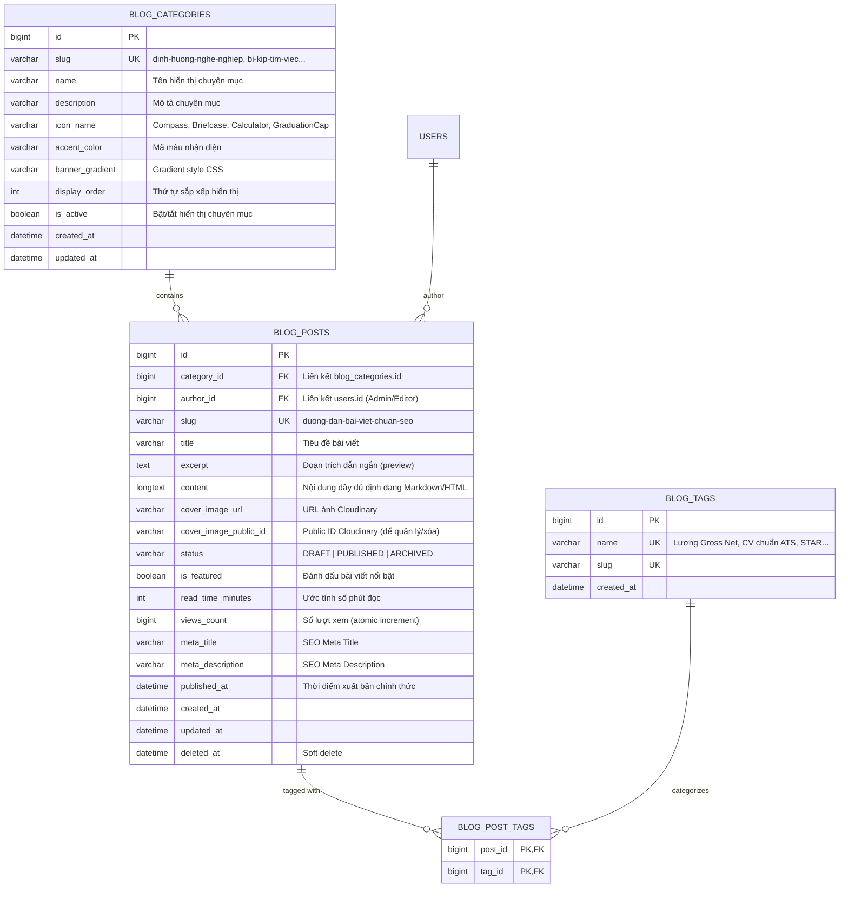
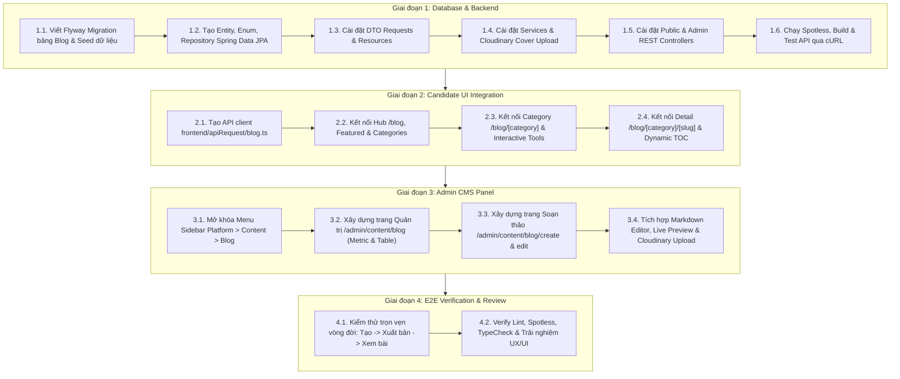

# Kế hoạch Kiến trúc & Lộ trình Triển khai Module Blog / Cẩm Nang Nghề Nghiệp (Blog & Career Guide Architecture & Roadmap)

> **Tài liệu Kỹ thuật & Nghiệp vụ Chuẩn cấp độ Production**  
> **Dự án:** InterVue Platform (AI-Assisted IT Recruitment)  
> **Phân hệ:** Quản lý Nội dung Cẩm nang Nghề nghiệp & Công cụ Tương tác Ứng viên (Blog & Candidate Career Tools)  
> **Phạm vi:** Backend (Spring Boot 4.1, Java 25, MySQL, Redis, Cloudinary) & Frontend (Next.js 16, React 19, Tailwind 4)  
> **Trạng thái:** Kế hoạch chính thức phê duyệt thực thi  

---

## 1. Tầm nhìn & Mục tiêu Nghiệp vụ (Vision & Strategic Objectives)

Phân hệ **Blog / Cẩm nang Nghề nghiệp** trên InterVue không đơn thuần chỉ là một trang tin tức thông thường mà là một **trụ cột chiến lược về Tăng trưởng Ứng viên (Organic Growth & Inbound Acquisition)** và **Giữ chân Người dùng (User Engagement & Retention)**:

1. **Thu hút Ứng viên Tự nhiên (Inbound SEO Acquisition):**
   - Đạt thứ hạng cao trên các công cụ tìm kiếm với các từ khóa tuyển dụng vàng: *viết CV chuẩn ATS, mô hình STAR phỏng vấn, tính lương gross sang net 2026, lộ trình thăng tiến IT/Marketing*.
   - Khai thác tối đa kiến trúc Next.js 16 Server Components kết hợp Incremental Static Regeneration (ISR) và Metadata/JSON-LD Rich Snippets chuẩn SEO.
2. **Kích hoạt Hành động bằng Bộ Công cụ Tương tác (Interactive Career Tools):**
   - Biến người đọc vãng lai thành ứng viên đăng ký tài khoản thông qua 3 tiện ích tương tác cao cấp gắn liền với từng chuyên mục:
     * **Công cụ tính Lương Gross ➔ Net 2026:** Bóc tách BHXH (10.5%), giảm trừ gia cảnh 11 triệu, thuế TNCN 7 bậc lũy tiến.
     * **Interactive Checklist chuẩn bị phỏng vấn:** 9 bước thực chiến theo mô hình STAR có thanh tiến độ % sẵn sàng.
     * **Bài trắc nghiệm Định hướng Nghề nghiệp Ikigai:** 2 bước khám phá năng lực và đề xuất công việc, bài viết tương ứng.
3. **Quản trị Nội dung Toàn diện & Tiện lợi cho Admin (CMS Governance):**
   - Trang quản trị chuyên nghiệp chuẩn Admin InterVue (`/admin/content/blog`), mở khóa menu Platform > Content > Blog.
   - Soạn thảo nội dung dạng Markdown/WYSIWYG trực quan kèm Live Preview, upload ảnh bìa trực tiếp lên Cloudinary, quản lý trạng thái Bản nháp (`DRAFT`) / Xuất bản (`PUBLISHED`), ghim bài Nổi bật (`is_featured`), và đo lường lượt xem thực tế.

---

## 2. Báo cáo Hiện trạng Kỹ thuật & Khoảng trống Cần Bù đắp (Gap Analysis)

| Hạng mục | Hiện trạng thực tế | Khoảng trống cần bù đắp (Gap) |
|---|---|---|
| **Cơ sở dữ liệu** | Chưa có bất kỳ bảng dữ liệu nào cho blog/category/tag. | Cần tạo migration Flyway: `blog_categories`, `blog_posts`, `blog_tags`, `blog_post_tags`. |
| **Backend API** | Chưa có package `modules/content`, chưa có entity/service/controller. | Cần tạo trọn bộ module `com.techx.intervue.modules.content`: Public API (xem bài, lọc, view counter) & Admin API (CRUD, Cloudinary uploader, summary). |
| **Dữ liệu mẫu (Seed)** | Dữ liệu phong phú đang bị "đóng băng" trong `frontend/mocks/blog.mock.ts` (~955 dòng code). | Cần viết migration seed đưa toàn bộ danh mục, tags và bài viết mẫu chất lượng cao vào DB MySQL. |
| **Candidate UI** | Giao diện `/blog` và `/blog/[category]` đẹp mắt nhưng 100% chạy dữ liệu mock. Nội dung bài viết đang lưu dưới dạng mảng JSON `sections` phân mảnh. | Thay thế mock bằng API client thực tế; hỗ trợ render Markdown chuẩn SEO kèm tự động sinh mục lục (TOC); duy trì và tối ưu 3 công cụ tương tác. |
| **Admin UI** | Menu Sidebar mục Blog bị đánh dấu `comingSoon: true`; chưa có bất kỳ trang quản trị nào tại `/admin/content/blog`. | Mở khóa menu sidebar, xây dựng màn hình Danh sách/Thống kê bài viết và màn hình Soạn thảo bài viết (Markdown + Live Preview + Cover Uploader). |

---

## 3. Thiết kế Kiến trúc Cơ sở Dữ liệu (Database Architecture)

### 3.1. Sơ đồ Thực thể Liên kết (Entity Relationship Diagram)



### 3.2. Migration & Dữ liệu Seed:
- **Migration Flyway `V20261106001__create_blog_tables.sql`:** Tạo bảng với ràng buộc khóa ngoại, chỉ mục `slug`, `category_id`, `status`, `is_featured`, `created_at`.
- **Migration Flyway `V20261106002__seed_blog_categories_and_posts.sql`:** Seed 4 chuyên mục cốt lõi và các bài viết cẩm nang nghề nghiệp thực chiến lấy từ mock hiện tại, giúp hệ thống có ngay kho nội dung chuẩn chỉnh ngay sau khi migrate.

---

## 4. Thiết kế Backend (`modules/content`)

Module tuân thủ cấu trúc chuẩn đã quy hoạch tại `docs/ai/architecture.md`:

```
backend/src/main/java/com/techx/intervue/modules/content/
├── controllers/
│   ├── PublicBlogController.java            // Cung cấp dữ liệu public cho ứng viên
│   └── AdminBlogController.java             // Cung cấp API quản trị cho Admin
├── entities/
│   ├── BlogCategory.java
│   ├── BlogPost.java
│   └── BlogTag.java
├── enums/
│   └── BlogPostStatus.java                  // DRAFT, PUBLISHED, ARCHIVED
├── repositories/
│   ├── BlogCategoryRepository.java
│   ├── BlogPostRepository.java              // Kèm JpaSpecificationExecutor để search động
│   └── BlogTagRepository.java
├── requests/
│   ├── CreateBlogPostRequest.java           // Validate tiêu đề, nội dung, danh mục, tags
│   ├── UpdateBlogPostRequest.java
│   ├── SearchBlogPostRequest.java           // Lọc categorySlug, tag, keyword, phân trang
│   └── AdminSearchBlogRequest.java          // Lọc status, categoryId, keyword, phân trang
├── resources/
│   ├── BlogCategoryResource.java            // Thông tin chuyên mục kèm số lượng bài
│   ├── BlogPostListResource.java            // DTO danh sách rút gọn (tối ưu payload)
│   ├── BlogPostDetailResource.java          // DTO chi tiết đầy đủ nội dung, tác giả, tags
│   └── AdminBlogSummaryResource.java        // Dashboard số liệu tổng quan của Admin
├── mappers/
│   └── BlogMapper.java                      // Ánh xạ Entity <-> Resource
└── services/
    ├── interfaces/
    │   ├── BlogServiceInterface.java        // Nghiệp vụ tra cứu cho Candidate
    │   └── AdminBlogServiceInterface.java   // Nghiệp vụ quản lý & Cloudinary cho Admin
    └── impl/
        ├── BlogService.java
        └── AdminBlogService.java
```

### 4.1. Đặc tả Chi tiết REST API:

#### A. Public API (Dành cho Ứng viên & Khách vãng lai):
- `GET /api/v1/blogs/categories`: Lấy danh sách 4 chuyên mục kèm số bài viết đang xuất bản.
- `GET /api/v1/blogs`: Danh sách bài viết có phân trang (`PageResource<BlogPostListResource>`), hỗ trợ lọc `categorySlug`, `tag`, `keyword`.
- `GET /api/v1/blogs/featured`: Lấy danh sách các bài viết nổi bật (`is_featured = true`) cho Banner & Grid trang Hub.
- `GET /api/v1/blogs/{categorySlug}/{slug}`: Lấy chi tiết bài viết, tự động tăng `views_count` nguyên tử (Atomic increment).
- `GET /api/v1/blogs/{categorySlug}/{slug}/related`: Lấy 3 bài viết liên quan cùng chuyên mục.

#### B. Admin API (Dành riêng cho Quản trị viên - `@PreAuthorize("hasRole('ADMIN')")`):
- `GET /api/v1/admin/blogs/summary`: Số liệu thống kê nhanh (Tổng số bài, Đã xuất bản, Bản nháp, Tổng lượt xem).
- `GET /api/v1/admin/blogs`: Tìm kiếm & duyệt danh sách bài viết quản trị (phân trang, lọc theo trạng thái, chuyên mục, từ khóa).
- `GET /api/v1/admin/blogs/{id}`: Chi tiết bài viết phục vụ màn hình Edit.
- `POST /api/v1/admin/blogs`: Tạo bài viết mới (hỗ trợ lưu nháp hoặc xuất bản ngay).
- `POST /api/v1/admin/blogs/cover-image`: Upload file ảnh bìa lên Cloudinary (`StorageTarget.IMAGE`, thư mục `blogs/covers`), trả về URL công khai và public ID.
- `PUT /api/v1/admin/blogs/{id}`: Cập nhật thông tin bài viết.
- `PATCH /api/v1/admin/blogs/{id}/status`: Chuyển đổi trạng thái nhanh (`DRAFT` ⇄ `PUBLISHED`).
- `PATCH /api/v1/admin/blogs/{id}/featured`: Bật/tắt ghim nổi bật.
- `DELETE /api/v1/admin/blogs/{id}`: Xóa mềm bài viết (`deleted_at`).

---

## 5. Thiết kế Frontend Quản trị Admin (`/admin/content/blog`)

### 5.1. Mở khóa Menu Sidebar & Định tuyến:
- Cập nhật [`frontend/constants/admin-nav.ts`](file:///Users/maaitlunghau/Documents/Projects/intervue/frontend/constants/admin-nav.ts#L193):
  Chuyển `comingSoon: false` cho mục `Blog` (`ROUTES.ADMIN_CONTENT_BLOG = '/admin/content/blog'`).
- Khởi tạo thư mục route: `frontend/app/(admin)/admin/content/blog/`.

### 5.2. Màn hình Danh sách & Thống kê (`/admin/content/blog/page.tsx`):
1. **Thanh Thống kê Chỉ số (Metric Strip):**
   - Tổng bài viết (Total Articles).
   - Đã xuất bản (Published - xanh lá).
   - Bản nháp (Drafts - vàng cam).
   - Tổng lượt xem tích lũy (Total Pageviews).
2. **Thanh Bộ lọc Linh hoạt (Filter Bar):**
   - Ô tìm kiếm tiêu đề bài viết / tác giả (Debounced search).
   - Dropdown chọn Chuyên mục.
   - Dropdown lọc Trạng thái (`Tất cả`, `Đã xuất bản`, `Bản nháp`).
   - Nút hành động chính: `+ Viết bài mới` (dẫn tới `/admin/content/blog/create`).
3. **Bảng Dữ liệu Quản trị (Admin Articles Table):**
   - Ảnh bìa thumbnail nhỏ + Tiêu đề bài viết + Slug.
   - Badge Chuyên mục (Màu sắc nhận diện theo từng trụ cột).
   - Badge Trạng thái (`Xuất bản` / `Bản nháp`).
   - Nút Toggle `Nổi bật` (Featured switch) tương tác trực tiếp.
   - Lượt xem & Ngày cập nhật gần nhất.
   - Cột Thao tác: Xem bài trực tiếp trên Candidate UI (External Link), Chỉnh sửa bài viết, Đổi trạng thái, Xóa bài.

### 5.3. Màn hình Soạn thảo Bài viết (`/admin/content/blog/create` & `.../[id]/edit`):
Giao diện 2 cột hiện đại chuẩn CMS:
- **Cột Trái (Nội dung chính - 70%):**
  - Input Tiêu đề bài viết: Tự động chuyển đổi thành Slug chuẩn SEO (hỗ trợ nhập đè tùy chỉnh).
  - Input Trích dẫn ngắn (Excerpt): Tóm tắt 2-3 câu khơi gợi sự tò mò.
  - **Trình soạn thảo Markdown chuyên nghiệp (Markdown Editor + Live Preview):**
    - Toolbar: Heading (H2, H3), Bold, Italic, Bullet List, Numbered List, Blockquote, Code block, Chèn link, Chèn ảnh.
    - Tab chuyển đổi linh hoạt: `Soạn thảo` | `Xem trước (Preview)`.
- **Cột Phải (Cấu hình & Xuất bản - 30%):**
  - **Khu vực Upload Ảnh bìa (Cover Image):** Hỗ trợ kéo thả ảnh, hiển thị preview ngay lập tức, nút upload trực tiếp lên Cloudinary.
  - Dropdown chọn Chuyên mục.
  - Quản lý Tags (nhập tag dạng chip badge, tự động gợi ý các tag phổ biến như `#Lương Gross Net`, `#CV chuẩn ATS`).
  - Cấu hình SEO: Nhập Meta Title, Meta Description kèm hộp mô phỏng kết quả tìm kiếm trên Google (SERP Preview).
  - Switch ghim bài Nổi bật (`is_featured`).
  - Cụm nút hành động dính (Sticky Action Bar): `Lưu bản nháp` và `Xuất bản bài viết`.

---

## 6. Thiết kế Tối ưu Frontend Phía Candidate (`/blog`)

1. **Kết nối API Real-time:**
   - Xây dựng API Client [`frontend/apiRequest/blog.ts`](file:///Users/maaitlunghau/Documents/Projects/intervue/frontend/apiRequest/blog.ts) kế thừa từ `http.ts`.
   - Chuyển đổi các trang `app/blog/page.tsx`, `app/blog/[category]/page.tsx`, và `app/blog/[category]/[slug]/page.tsx` sang fetch dữ liệu thật từ Backend API.
2. **Cơ chế Caching & SEO (Next.js 16 Server Components):**
   - Thiết lập `revalidate = 60` hoặc cơ chế revalidate tag `revalidateTag('blogs')` để trang vừa phản hồi tức thì với tốc độ siêu nhanh (Core Web Vitals điểm cao), vừa tự động cập nhật ngay khi Admin xuất bản bài mới.
   - Hàm `generateMetadata` trích xuất động tiêu đề, mô tả, ảnh cover, thẻ canonical và Schema.org Article.
3. **Trình hiển thị Nội dung Markdown & Mục lục Động (Dynamic Table of Contents):**
   - Render nội dung bài viết mượt mà từ định dạng Markdown sang HTML an toàn, căn chỉnh kiểu chữ typographic sắc nét.
   - Cột trái tự động quét các thẻ `<h2>`, `<h3>` trong bài để sinh ra **Table of Contents (TOC)** bám dính khi cuộn màn hình (sticky scroll-spy), bấm vào tiêu đề mục nào thì tự cuộn mượt (smooth scroll) đến đúng đoạn đó.
4. **Bảo tồn & Nâng cấp 3 Công cụ Tương tác Trọng yếu:**
   - **Chuyên mục Chế độ lương thưởng (`/blog/che-do-luong-thuong`):** Tích hợp công cụ [`GrossNetCalculatorWidget`](file:///Users/maaitlunghau/Documents/Projects/intervue/frontend/components/blog/GrossNetCalculatorWidget.tsx) tính lương chuẩn xác theo biểu mẫu 2026.
   - **Chuyên mục Bí quyết tìm việc (`/blog/bi-kip-tim-viec`):** Tích hợp công cụ [`InterviewPrepChecklist`](file:///Users/maaitlunghau/Documents/Projects/intervue/frontend/components/blog/InterviewPrepChecklist.tsx) theo mô hình STAR có ghi nhớ trạng thái checkbox cục bộ.
   - **Chuyên mục Định hướng nghề nghiệp (`/blog/dinh-huong-nghe-nghiep`):** Tích hợp công cụ [`CareerAssessmentBanner`](file:///Users/maaitlunghau/Documents/Projects/intervue/frontend/components/career-orientation/CareerAssessmentBanner.tsx) làm mini trắc nghiệm Ikigai chọn ngành nghề phù hợp.

---

## 7. Lộ trình Thực thi Từng Bước (Execution Steps)



---

## 8. Tiêu chí Hoàn thành & Nghiệm thu (Definition of Done)

1. **Tính Toàn vẹn Dữ liệu:** Database MySQL có đầy đủ bảng và dữ liệu seed mẫu từ mock; không có lỗi ràng buộc khóa ngoại hay dữ liệu rác.
2. **Chuẩn mực Code & Architecture:**
   - Backend tuân thủ nghiêm ngặt mô hình phân tầng, không có code thừa, không dùng `@Data` trên Entity, sử dụng interface service, spotless clean.
   - Frontend không có `any`, form được validate chặt chẽ, hỗ trợ responsive hoàn hảo trên mọi kích thước màn hình (kể cả mobile 375px).
3. **Trải nghiệm Quản trị (Admin UX):** Admin có thể tạo bài viết mới, tải ảnh bìa lên Cloudinary thành công, xem trước nội dung Markdown mượt mà, chuyển đổi trạng thái Draft/Publish tức thì.
4. **Trải nghiệm Ứng viên (Candidate UX):** Ứng viên duyệt cẩm nang mượt mà, bài viết mới xuất bản hiển thị ngay trên trang Hub và chuyên mục, mục lục tự động cuộn đến tiêu đề, và cả 3 công cụ tương tác (Tính lương, Checklist phỏng vấn, Trắc nghiệm Ikigai) vận hành trơn tru.

