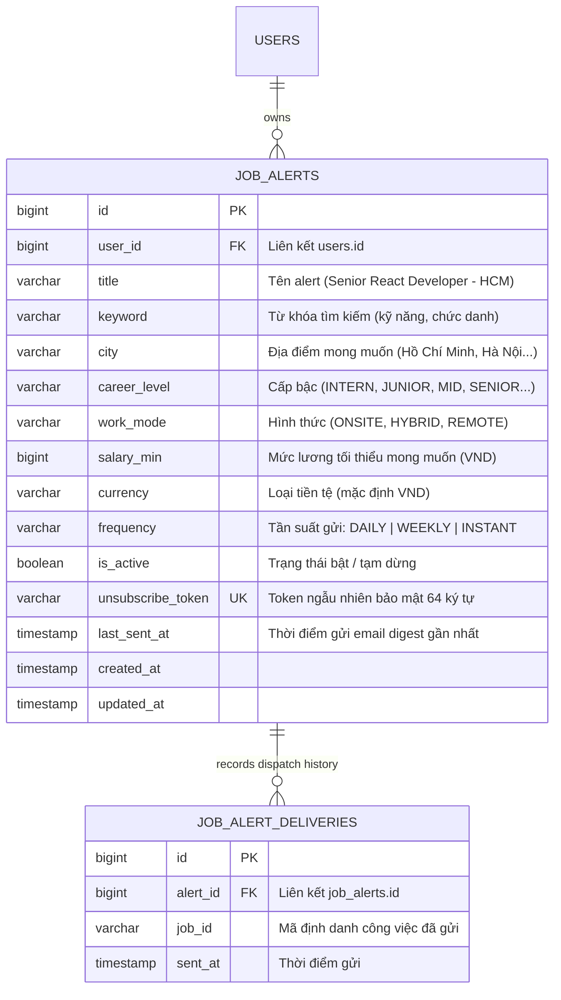

# Kế hoạch Kiến trúc & Lộ trình Triển khai Module Job Alert (Job Alert Architecture & Roadmap)

> **Tài liệu Kỹ thuật & Nghiệp vụ Chuẩn cấp độ Production**  
> **Dự án:** InterVue Platform (AI-Assisted IT Recruitment)  
> **Phân hệ:** Quản lý Thông báo Việc làm Tự động & Email Digest (Job Alert & Smart Push Matching)  
> **Phạm vi:** Backend (Spring Boot 4.1, Java 25, MySQL, SmtpMailService, Redis) & Frontend (Next.js 16, React 19, Tailwind 4)  
> **Trạng thái:** Kế hoạch chính thức phê duyệt thực thi  

---

## 1. Tầm nhìn & Mục tiêu Nghiệp vụ (Vision & Strategic Objectives)

Tính năng **Job Alert (Thông báo việc làm)** trên nền tảng InterVue là một trong những trụ cột quan trọng nhất nhằm tối ưu hóa vòng đời ứng viên (Candidate Lifecycle) và tăng cường tỷ lệ giữ chân người dùng (User Retention):

1. **Tiếp cận & Đánh thức Nhóm Ứng viên Thụ động (Passive Candidates Re-engagement):**
   - Hơn 70% nhân sự IT chất lượng cao không chủ động truy cập website tuyển dụng mỗi ngày.
   - Job Alert hoạt động như một "trợ lý tuyển dụng cá nhân" 24/7: Khi có tin tuyển dụng mới khớp với bộ lọc kỹ năng (Java, React, Golang...), địa điểm (TP. HCM, Hà Nội...) và kỳ vọng thu nhập, hệ thống sẽ tự động quét và gửi email tổng hợp (Email Digest) vào đầu ngày (07:30 - 08:00 AM).
2. **Tối ưu Hóa Trải nghiệm & Giảm Thiểu Thao tác Thủ công (Frictionless UX):**
   - Thay vì phải nhớ và gõ lại bộ lọc tìm kiếm trên thanh search mỗi lần vào app, ứng viên chỉ cần bấm **"Nhận thông báo cho tìm kiếm này"** (Save Search as Alert).
   - Đảm bảo quyền kiểm soát linh hoạt: Ứng viên có thể bật/tắt (Pause/Resume), đổi tần suất (Hằng ngày / Hằng tuần), hoặc chỉnh sửa bộ lọc bất cứ lúc nào.
3. **Hoàn thiện Bước 4 trong Luồng Onboarding Ứng viên:**
   - Theo quy chuẩn nghiệp vụ InterVue (`docs/candidate-features.md` mục 5.1), ngay sau khi đăng ký, tải CV và xác nhận vị trí mong muốn, bước thứ 4 là **"Bật thông báo việc làm (Job alert)"**.
4. **Tuân thủ Chuẩn mực Email Quốc tế (RFC 8058 One-Click Unsubscribe & Anti-Spam):**
   - Mọi email gửi đi bắt buộc phải có liên kết hủy nhận thông báo bằng 1 lần bấm (`unsubscribe_token`), cho phép ứng viên tạm dừng hoặc xóa alert mà **không cần đăng nhập**, bảo vệ uy tín tên miền (Domain Reputation) và tránh rơi vào hòm thư SPAM.

---

## 2. Báo cáo Hiện trạng Kỹ thuật & Khoảng trống Cần Bù đắp (Gap Analysis)

| Hạng mục | Hiện trạng thực tế | Khoảng trống cần bù đắp (Gap) |
|---|---|---|
| **Cơ sở dữ liệu** | Chưa có bảng dữ liệu nào phục vụ Job Alert. Bảng `jobs` của Recruiter đang trong lộ trình phát triển. | Cần tạo migration Flyway: `job_alerts` (lưu cấu hình alert, tiêu chí lọc, unsubscribe token) và `job_alert_deliveries` (lịch sử gửi và chống gửi trùng lặp). |
| **Backend Core & API** | Chưa có module `jobalert`. | Cần xây dựng trọn bộ `com.techx.intervue.modules.jobalert`: Entity, Repository, DTOs, Candidate CRUD Service & Controller, Public Unsubscribe API (không cần login). |
| **Matching & Dispatch Engine** | Chưa có cơ chế quét tin tự động theo lịch. Đã có sẵn `JobSearchServiceInterface` với kho dữ liệu IT jobs phong phú. | Tận dụng `JobSearchServiceInterface` làm nguồn quét tin khớp; xây dựng `JobAlertDispatchService` và Spring Scheduler (`@Scheduled`) chạy định kỳ 08:00 AM. |
| **Email Template** | Đã có hệ thống template HTML chuyên nghiệp tại `resources/templates/mail/` (`verify-email.html`, `business-document-reviewed.html`...). Chưa có template Job Digest. | Tận dụng 100% khung sườn thiết kế chuẩn của InterVue (Header banner, font Orbitron/Roboto, bảng viền bo góc `#009d4f`, footer bản quyền) để tạo `job-alert-digest.html` đồng bộ và sang trọng. |
| **Frontend UI/UX** | Chưa có trang quản lý Alert tại `/candidate/job-alerts`; nút tạo alert trên trang tìm việc chưa kết nối API; chưa có trang xác nhận hủy đăng ký `/job-alerts/unsubscribe`. | Xây dựng trang `/candidate/job-alerts`, component `JobAlertModal.tsx` tái sử dụng, trang xử lý token `/job-alerts/unsubscribe`, và API client `frontend/apiRequest/job-alert.ts`. |
| **Tách biệt với Claude CLI** | Claude CLI trong VSCode đang hoàn thiện module `notification` (in-app notifications, eKYC events) trên branch `dev`. | Job Alert được thiết kế hoàn toàn độc lập trong `modules/jobalert`, sử dụng email qua `SmtpMailService` và phát `JobAlertMatchedEvent` qua Spring Event Bus, cam kết không gây xung đột git. |

---

## 3. Thiết kế Cơ sở Dữ liệu (Database Architecture)

### 3.1. Sơ đồ Thực thể Liên kết (Entity Relationship Diagram)



### 3.2. Chi tiết Migration Flyway (`V20261108001__create_job_alerts_tables.sql`)

```sql
-- ============================================================================
-- Migration: V20261108001__create_job_alerts_tables.sql
-- Description: Store candidate job alerts and delivery history for deduplication
-- ============================================================================

CREATE TABLE IF NOT EXISTS job_alerts (
    id BIGINT UNSIGNED AUTO_INCREMENT PRIMARY KEY,
    user_id BIGINT UNSIGNED NOT NULL,
    title VARCHAR(150) NOT NULL,
    keyword VARCHAR(255) NULL,
    city VARCHAR(100) NULL,
    career_level VARCHAR(30) NULL,
    work_mode VARCHAR(30) NULL,
    salary_min BIGINT UNSIGNED NULL,
    currency VARCHAR(10) NOT NULL DEFAULT 'VND',
    frequency VARCHAR(20) NOT NULL DEFAULT 'DAILY',
    is_active BOOLEAN NOT NULL DEFAULT TRUE,
    unsubscribe_token VARCHAR(64) NOT NULL UNIQUE,
    last_sent_at TIMESTAMP NULL,
    created_at TIMESTAMP NOT NULL DEFAULT CURRENT_TIMESTAMP,
    updated_at TIMESTAMP NOT NULL DEFAULT CURRENT_TIMESTAMP ON UPDATE CURRENT_TIMESTAMP,
    CONSTRAINT fk_job_alerts_user FOREIGN KEY (user_id) REFERENCES users(id) ON DELETE CASCADE,
    INDEX idx_job_alerts_dispatch (is_active, frequency, last_sent_at),
    INDEX idx_job_alerts_user (user_id)
) ENGINE = InnoDB DEFAULT CHARSET = utf8mb4 COLLATE = utf8mb4_unicode_ci;

CREATE TABLE IF NOT EXISTS job_alert_deliveries (
    id BIGINT UNSIGNED AUTO_INCREMENT PRIMARY KEY,
    alert_id BIGINT UNSIGNED NOT NULL,
    job_id VARCHAR(64) NOT NULL,
    sent_at TIMESTAMP NOT NULL DEFAULT CURRENT_TIMESTAMP,
    CONSTRAINT fk_job_alert_deliveries_alert FOREIGN KEY (alert_id) REFERENCES job_alerts(id) ON DELETE CASCADE,
    CONSTRAINT uq_alert_job_delivery UNIQUE (alert_id, job_id),
    INDEX idx_job_alert_deliveries_alert (alert_id)
) ENGINE = InnoDB DEFAULT CHARSET = utf8mb4 COLLATE = utf8mb4_unicode_ci;
```

---

## 4. Kiến trúc Backend & Matching Engine (Backend Architecture)

### 4.1. Cấu trúc Package & Phân lớp Mã nguồn

```
backend/src/main/java/com/techx/intervue/modules/jobalert/
├── entities/
│   ├── JobAlert.java                      -- JPA entity bảng job_alerts
│   └── JobAlertDelivery.java              -- JPA entity bảng job_alert_deliveries
├── enums/
│   └── AlertFrequency.java                -- DAILY, WEEKLY, INSTANT
├── repositories/
│   ├── JobAlertRepository.java            -- Query alerts theo user, active, frequency
│   └── JobAlertDeliveryRepository.java    -- Check job_id đã gửi & batch insert
├── requests/
│   ├── CreateJobAlertRequest.java         -- Validate title, keyword, city, frequency
│   └── UpdateJobAlertRequest.java         -- Validate cập nhật tiêu chí
├── resources/
│   ├── JobAlertResource.java              -- Output DTO cho Candidate
│   ├── JobAlertSummaryResource.java       -- Thống kê tổng quan (active, total, sent)
│   └── JobAlertUnsubscribeResource.java   -- Output cho màn hình hủy đăng ký
├── mappers/
│   └── JobAlertMapper.java                -- Entity <-> DTO mapper
├── services/
│   ├── interfaces/
│   │   ├── JobAlertServiceInterface.java          -- CRUD, Toggle, Unsubscribe
│   │   └── JobAlertDispatchServiceInterface.java  -- Quét tin khớp & gửi digest
│   └── impl/
│       ├── JobAlertService.java                   -- Cài đặt nghiệp vụ Alert
│       ├── JobAlertDispatchService.java           -- Matching engine & Smtp Mail integration
│       └── JobAlertScheduler.java                 -- Spring @Scheduled cron runner
├── controllers/
│   ├── CandidateJobAlertController.java   -- /api/v1/candidate/job-alerts (JWT Candidate)
│   └── PublicJobAlertController.java      -- /api/v1/job-alerts/unsubscribe (Public)
└── events/
    └── JobAlertMatchedEvent.java          -- Event bus decoupling
```

### 4.2. Nguyên lý Hoạt động của Matching & Deduplication Engine

1. **Bộ quét Lịch trình (JobAlertScheduler):**
   - `@Scheduled(cron = "0 0 8 * * *")` (Chạy mỗi 08:00 AM hằng ngày): Quét tất cả alert `is_active = true` có tần suất `DAILY`.
   - Vào thứ Hai hằng tuần, quét thêm các alert có tần suất `WEEKLY`.
2. **Khớp Tiêu chí (Smart Matching):**
   - Gọi `JobSearchServiceInterface.search(keyword, city, level, 10)` để tìm các tin tuyển dụng liên quan.
   - Kiểm tra thêm điều kiện về `salaryMin` và `workMode` nếu alert có yêu cầu.
3. **Chống Gửi Trùng lặp (Deduplication):**
   - Lấy danh sách `job_id` đã từng gửi cho alert này từ `job_alert_deliveries`.
   - Lọc bỏ tất cả tin đã gửi trước đó: `List<JobSearchResult> newMatches = matches.stream().filter(j -> !deliveredJobIds.contains(j.id())).toList()`.
   - Chỉ khi `newMatches` có ít nhất 1 tin tuyển dụng mới thì hệ thống mới tiến hành gửi email.
4. **Gửi Thử Nghiệm (Send Test Email):**
   - Cung cấp API `POST /api/v1/candidate/job-alerts/{id}/test-send` để ứng viên có thể thử nghiệm nhận ngay email digest vào hòm thư cá nhân để xem trước kết quả trực quan.

### 4.3. Thiết kế Email Digest HTML Đồng bộ Brand InterVue

Template được đặt tại `backend/src/main/resources/templates/mail/job-alert-digest.html`:
- Tái sử dụng trọn vẹn phong cách thiết kế từ `verify-email.html`:
  - Header Banner với logo InterVue và slogan công nghệ.
  - Tiêu đề Font Orbitron: **"JOB OPPORTUNITIES DIGEST"**.
  - Khung nội dung chính bo góc 20px với đường viền `#009d4f`.
  - Danh sách thẻ việc làm (Job Cards): Tên công việc, Công ty, Mức lương badge xanh lá, Địa điểm, Tags kỹ năng, và nút **"Ứng tuyển ngay"**.
  - Link One-Click Unsubscribe ở chân trang: `{{unsubscribeUrl}}` kèm thông điệp rõ ràng giúp người dùng có thể tắt thông báo bất cứ lúc nào.

---

## 5. Thiết kế Giao diện Người dùng & UI/UX (Frontend Architecture)

### 5.1. Định vị & Luồng Trải nghiệm Người dùng (User Journey)

```
[Màn hình Tìm việc /jobs]
   └── Bấm nút: "🔔 Nhận thông báo cho tìm kiếm này"
            │ (Tự động điền trước Keyword & City)
            ▼
[Modal Tạo Alert Thân thiện] ─── Lưu ───► [Lưu thành công, thông báo Toast]
                                                │
                                                ▼ Xem & Quản lý
[Trang Quản lý Alert: /candidate/job-alerts]
   ├── Header: Tiêu đề, Breadcrumb, Thẻ tóm tắt số alert đang bật
   ├── Toolbar: Tìm kiếm alert, Nút "+ Create Job Alert"
   ├── Danh sách Cards/Table:
   │     • Tên Alert & Badge Tần suất (Daily / Weekly)
   │     • Tiêu chí chi tiết: Từ khóa, Địa điểm, Cấp bậc, Lương tối thiểu
   │     • Lần gửi gần nhất (e.g., "Hôm nay lúc 08:00" hoặc "Chưa gửi")
   │     • Switch Toggle Bật/Tắt (Active / Paused) tức thì (Optimistic UI)
   │     • Nút "Send Test Email": Gửi thử ngay 1 email mẫu để kiểm tra
   │     • Nút "Edit" & Nút "Delete" (kèm dialog xác nhận)
   └── Empty State: Thân thiện, minh họa sinh động khi chưa có alert nào

[Email Digest trong Hộp thư Gmail/Outlook]
   └── Bấm link "Hủy nhận thông báo" ở chân email
            │
            ▼
[Trang Public: /job-alerts/unsubscribe?token=xxx]
   ├── Không bắt buộc đăng nhập
   ├── Hiển thị chi tiết Alert: "Senior React Developer tại TP. Hồ Chí Minh"
   ├── 2 Lựa chọn thân thiện:
   │     1. [Pause Alerts] - Tạm dừng nhận email (có thể bật lại sau)
   │     2. [Delete Alert] - Xóa hoàn toàn thông báo này
   └── Thông báo xác nhận thành công rõ ràng
```

### 5.2. Nguyên tắc Thiết kế UI/UX
- **English-First & Professional:** Toàn bộ nhãn, nút bấm, placeholder trên giao diện tuân thủ chuẩn English-first của InterVue (`Job Title`, `Location`, `Experience Level`, `Expected Minimum Salary`, `Frequency`).
- **Thân thiện, Không Mang Hướng AI Máy Móc:** Giao diện tập trung vào tính rõ ràng, dễ hiểu, các thẻ badge bo tròn nhẹ, độ tương phản màu sắc cao, hiệu ứng hover mượt mà tương đồng với trang Hồ sơ Ứng viên (`/candidate/profile`).
- **Responsive Hoàn hảo:** Tương thích từ màn hình Mobile (dạng Cards dọc) đến Tablet/Desktop (bảng quản trị hiện đại).

---

## 6. Lộ trình Triển khai Chi tiết (Phased Execution Plan)

### Phase 1: Database Migration
- [ ] Viết script Flyway migration `V20261108001__create_job_alerts_tables.sql`.
- [ ] Kiểm tra tính toàn vẹn khóa ngoại `users(id)` và các chỉ mục hiệu năng (`idx_job_alerts_dispatch`).

### Phase 2: Backend Entities, Repositories & Candidate CRUD APIs
- [ ] Tạo entity `JobAlert.java` và `JobAlertDelivery.java`.
- [ ] Tạo repository `JobAlertRepository` và `JobAlertDeliveryRepository`.
- [ ] Tạo request DTOs (`CreateJobAlertRequest`, `UpdateJobAlertRequest`) và response DTOs (`JobAlertResource`, `JobAlertSummaryResource`).
- [ ] Cài đặt `JobAlertService`: CRUD, toggle active status, send test email.
- [ ] Cài đặt controller `CandidateJobAlertController` (`/api/v1/candidate/job-alerts`).

### Phase 3: Matching Engine, Email Template & One-Click Unsubscribe
- [ ] Tích hợp `JobSearchServiceInterface` vào `JobAlertDispatchService` để quét tin tuyển dụng khớp tiêu chí.
- [ ] Cài đặt cơ chế Deduplication dựa trên `job_alert_deliveries`.
- [ ] Mở rộng `MailServiceInterface` / `SmtpMailService` để hỗ trợ chèn danh sách job cards HTML vào template email.
- [ ] Tạo template HTML `job-alert-digest.html` dựa trên khung chuẩn InterVue.
- [ ] Cài đặt `JobAlertScheduler` với Spring `@Scheduled` chạy định kỳ.
- [ ] Cài đặt controller `PublicJobAlertController` (`/api/v1/job-alerts/unsubscribe`).

### Phase 4: Frontend API Client & Candidate Management UI
- [ ] Tạo API client `frontend/apiRequest/job-alert.ts` và types `frontend/types/job-alert.ts`.
- [ ] Xây dựng màn hình quản lý Alert tại `frontend/app/(candidate)/candidate/job-alerts/page.tsx` và view component `JobAlertsView.tsx`.
- [ ] Xây dựng modal `JobAlertModal.tsx` hỗ trợ tạo và cập nhật alert.
- [ ] Xây dựng trang public `frontend/app/job-alerts/unsubscribe/page.tsx` phục vụ hủy đăng ký 1-click.
- [ ] Gắn link Job Alerts vào thanh điều hướng bên Candidate.

### Phase 5: Verification, Testing & Polish
- [ ] Chạy build & test Backend (`mvn test-compile`, `mvn test`).
- [ ] Chạy lint & build Frontend (`npm run lint`, `npm run build`).
- [ ] Kiểm tra thực tế: Tạo alert, gửi test email digest, bấm link unsubscribe token, toggle trạng thái.
- [ ] Báo cáo kết quả và xác nhận trước khi commit.

